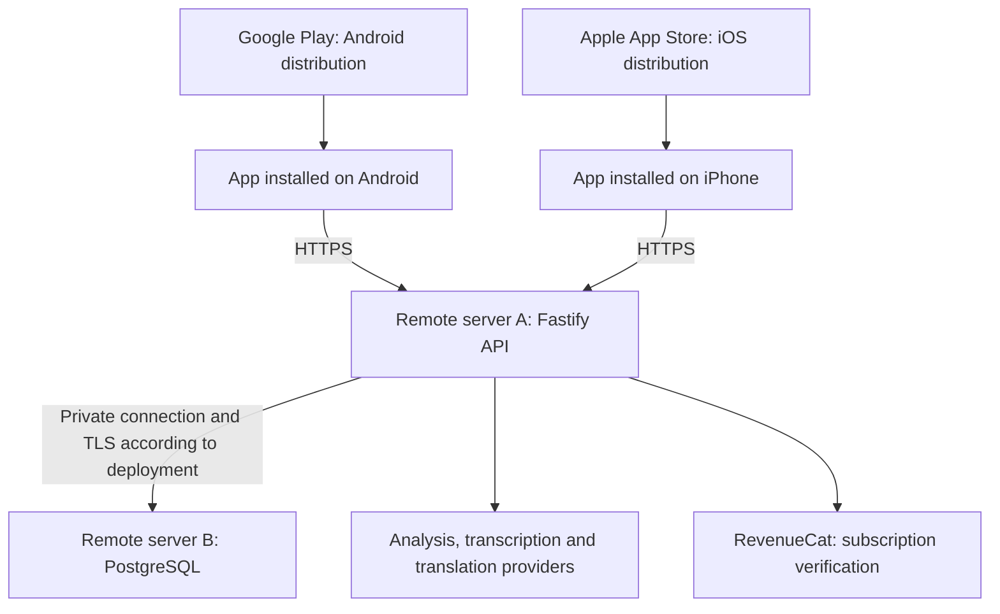

# AI Scam Shield

A mobile app for analysing text, URLs, images and short videos, identifying possible scams and displaying risk indicators. The client is built with Flutter and uses a Fastify API with PostgreSQL persistence.

English is the project language for source comments, identifiers and developer documentation. User-facing app text and legal documents remain localised.

## Distribution and production architecture

The app is installed on the phone from **Google Play for Android** or **Apple App Store for iOS**. There are two independent mobile builds, each with its own signing and publication process. Users need the installed app and an Internet connection; they do not need a computer, Docker, Ollama or direct database access.



| Component | Distribution or hosting | Responsibility |
|---|---|---|
| Android build | Google Play; `.aab` publication artefact | Client installed on Android |
| iOS build | Apple App Store; `.ipa` publication artefact | Client installed on iPhone |
| API | Remote server A | Authentication, analysis, quotas, subscriptions and statistics |
| PostgreSQL | Remote server B, separate from the API server | Sessions, operations, history, quotas and subscription status |

The stores distribute the mobile clients. The API and DB are deployed separately on remote infrastructure. Both clients connect to the same public HTTPS API; only the API accesses PostgreSQL. Database credentials and private provider keys remain on the API server.

## Project status

- **Android:** implementation undergoing validation. A debug build exists for local testing; device, provider and purchase testing and preparation for a signed Google Play release remain outstanding.
- **iOS:** the agreed second distribution target, awaiting native implementation and validation. The `app/ios` folder is a project foundation and does not establish that a publishable IPA is available. Outstanding work includes Apple signing, Firebase and RevenueCat configuration for iOS, permissions and receiving shared content.
- **Remote production:** this documentation establishes the API/DB separation. It does not mean those servers have already been deployed or verified; details and configuration for the final environment are still needed.

## Features and plans

- Text and URLs through copying and pasting or sharing with the app; images and videos through selection or sharing. The current sharing integration is Android; iOS integration is pending.
- OCR in the original language; results and explanations requested in the app language. Full OCR and audio coverage by language remains under evaluation.
- **Free:** 3 results per week. The first uses AI and supports any input type; the other 2 are text/URL without AI. Each complete operation counts as one unit; a valid inconclusive result counts, and a failure without a valid result does not. Resets on Monday at 00:00 in the session's registered time zone.
- **Premium:** analyses always use AI, with no commercial weekly quota. Technical and availability limits still apply.
- Videos up to 180 seconds inclusive and 100 MiB.
- History and statistics for today, the week, the last 30 days and the current year, with inconclusive results shown separately.
- Interface and legal documentation in the 24 official EU languages plus Catalan; British English.

The first Free analysis and Premium analyses require operational AI: a provider failure returns an error without consuming quota, rather than a classic result presented as an AI analysis.

## Repository

```text
app/                 Flutter client and native Android/iOS projects
api/                 Fastify API, business logic and PostgreSQL access
docs/                Privacy policy and terms in all 25 languages
privacy-policy.md    English policy generated from the shared legal source
```

## The two mobile builds

Both builds must explicitly include the remote API's HTTPS URL through `API_BASE_URL`. `https://api.example.com` is an example: replace it with server A's actual domain. Do not include `DATABASE_URL` or private provider keys in mobile builds.

Before packaging, review the version/build number and configure signing for each platform. The repository version is currently `3.3.0+11`; each new upload must use a version code/build number accepted by its store. The Android version 11 AAB has been prepared and checked locally for 16 KB alignment; see [the release verification](docs/android-release-11.md).

### Android → Google Play

From `app/`, with Flutter, the Android SDK, the JDK and Android release configuration prepared:

```sh
flutter pub get
flutter build appbundle --release --dart-define=API_BASE_URL=https://api.example.com
```

The AAB is generated in `app/build/app/outputs/bundle/release/` and submitted to Google Play Console. Release signing is configured privately through `app/android/key.properties` and the corresponding keystore; these files are not included in the repository. Android Firebase configuration is also supplied to the build environment.

### iOS → Apple App Store

This is the planned packaging workflow **after completing the iOS implementation**. It requires a macOS environment with Xcode and Apple signing/provisioning configuration. It cannot be generated from Windows.

From `app/`, once the native project, Firebase, Apple/RevenueCat purchases and permissions are ready:

```sh
flutter pub get
flutter build ipa --release --dart-define=API_BASE_URL=https://api.example.com
```

The archive is generated under `app/build/ios/archive/` and the IPA under `app/build/ios/ipa/`, for distribution through App Store Connect/TestFlight and App Store. This command documents the target workflow; an IPA for this delivery has not been built or validated.

Official references: [Android deployment with Flutter](https://docs.flutter.dev/deployment/android) and [iOS deployment with Flutter](https://docs.flutter.dev/deployment/ios).

## API and DB on separate remote servers

1. **Server B — PostgreSQL:** provision the DB and its credentials, network access from A, TLS/certificates, backups and a retention policy. Mobile clients do not access the PostgreSQL port.
2. **Server A — API:** deploy the API and configure `DATABASE_URL` with remote host B. Supply secrets through the server environment, provider configuration, `SESSION_RATE_LIMIT_SECRET` and RevenueCat in the `PRODUCTION` environment; keep `ALLOW_TEST_ADMIN=false` and `NODE_ENV=production`.
3. **HTTPS entry point:** configure server A's domain, certificate and HTTPS termination. The Node process listens on `PORT` —3000 by default—; the Dockerfile does not install an HTTPS proxy or a PostgreSQL server.
4. **Mobile clients:** build Android and iOS pointing to server A's public HTTPS URL and validate their flows against that environment before distribution.

The API can be packaged with its Dockerfile, independently of the mobile builds. From the repository root:

```sh
docker build --target runtime -t ai-scam-shield-api:release ./api
```

The image contains the API and ffmpeg, runs compiled JavaScript with Node 22 as user `node`, and receives configuration at startup. Startup applies pending migrations to the DB specified by `DATABASE_URL`; this must be planned for server B. PostgreSQL connectivity and certificate validation depend on deployment configuration and must be checked; placing the services on different machines is not sufficient.

Do not use the development `api/docker-compose.yml` as a description of production: it groups the API and DB for local testing. Actual domains, servers and credentials are not stored in this README or in the app packages. Further details are available in [API](api/README.md).

## Local development and testing

Docker Desktop, an emulator, a USB cable and `adb reverse` are developer tools. They are only needed when choosing to test against a local API; they are not part of normal use of an app downloaded from the stores.

The local environment for this work already has the API and PostgreSQL running in Docker. Reuse those services and their DB; do not create a parallel DB or replace their private files with `.env.example`. Specific instructions are in [the app README](app/README.md) and [the API README](api/README.md).

## Verification and documentation

```sh
node docs/generate-legal.mjs --check
node --test docs/legal-documents.test.mjs
```

For the app, run `flutter test` and `flutter analyze` from `app/`; for the API, run `npm test`, `npm run typecheck` and `npm run build` from `api/`. Current CI checks tests/builds and documentation; it does not publish to stores or deploy servers.

[Legal index](docs/index.html) · [Sources and pending legal review](docs/README.md) · [Mobile client](app/README.md) · [API](api/README.md).

## Licence

MIT. See [LICENSE](LICENSE).
